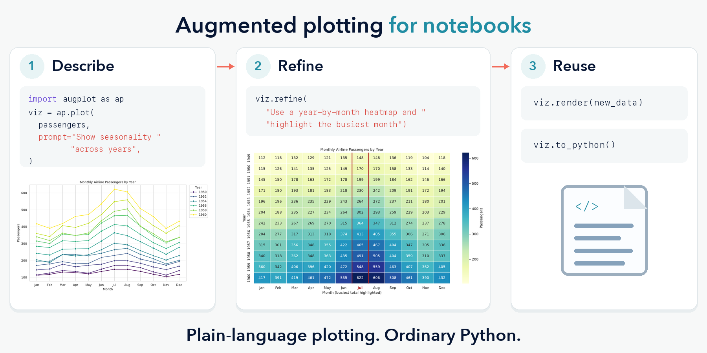

# Augplot



Pass Augplot your notebook data and describe what you want to see. Refine the
visualization in plain language, then reuse or export the generated Matplotlib or
Seaborn code.

## Quick start

Augplot supports Python 3.11 through 3.14.

```bash
pip install augplot
```

Sign in once with an eligible ChatGPT Plus or Pro account, then work directly with data
already in your notebook. No API key is needed:

```python
import augplot as ap

ap.sign_in()  # Opens your browser; remembers the connection securely.
flights = ap.load_sns_dataset("flights")
viz = ap.plot(
    flights,
    auth="chatgpt",
    prompt="Plot monthly airline passengers over time, with one line per year.",
)
viz.refine(
    "Turn this into a year-by-month heatmap and highlight the busiest month."
)
viz.to_python(function_name="plot_monthly_passengers")
```

Later sessions can skip `ap.sign_in()`. Model selection is automatic; optionally inspect
the models available to your account and change the default for future charts:

```python
ap.models()               # Model IDs, names, and the selected default.
ap.set_model("model-id")   # Use an ID returned by ap.models().
```

ChatGPT sign-in requires permission to use your plan's Codex / ChatGPT Work allowance.
The available models may differ from the ChatGPT picker and the API catalog. Extra
credits are optional and controlled in ChatGPT's Usage settings; included usage limits
still apply. See [OpenAI's sign-in guide](https://learn.chatgpt.com/docs/sign-in-with-chatgpt).
Existing API-key providers remain available; see [API-provider setup](#api-provider-setup).

Open or download the [example notebook](examples/quickstart.ipynb) to try the complete
workflow.

For nested cross-validation results, try the
[model comparison notebook](examples/cross-validation-model-comparison.ipynb). It starts
with an inline results dictionary, successive refinements, and an intentional
`ScopeError` example.

For a one-sentence plotting request on an open stellar catalog, try the
[Hertzsprung–Russell notebook](examples/hertzsprung-russell-one-shot.ipynb).
It requests fresh generation with a one-model-call budget. Grouped coverage summaries,
shared empirical smoothing, and direct curve labeling support this and other complex
charts. Inspect the figure and source: valid execution does not establish visual or
scientific correctness. See [the evaluation notes](docs/hr-evaluation.md) for recorded
live results and the sample's limitations.

## What can `data` be?

`ap.plot(data)` accepts these nonempty, in-memory Python objects:

| Input | Typical use |
| --- | --- |
| `pandas.DataFrame` | Rows and columns, including dates and categories. |
| `pandas.Series` | One labeled sequence of values. |
| `numpy.ndarray` | One- or two-dimensional numeric or mixed data. |
| `list` or `tuple` | Values such as `[2, 4, 6]`, or records such as `[{'x': 1, 'y': 2}]`. |
| `dict` | Columns such as `{'x': [1, 2], 'y': [2, 3]}`, or nested results keyed by model and metric. |

Nested lists and dictionaries can contain ordinary scalars, missing values, NumPy arrays,
and Pandas objects. Parsed JSON is therefore a valid input when its root is a nonempty
list or dictionary:

```python
import json

records = json.loads('[{"month": "Jan", "sales": 10}, {"month": "Feb", "sales": 12}]')
viz = ap.plot(records)

results = {
    "baseline": {"test_f1": [0.3, 0.4, 0.5]},
    "candidate": {"test_f1": [0.4, 0.5, 0.6]},
}
viz = ap.plot(results, prompt="Compare F1 scores across models")
```

Pass the parsed object, not a JSON string or file path. Empty inputs, cyclic containers,
custom objects, and NumPy arrays with zero or more than two dimensions raise `DataError`.
For a Pandas `Index`, another table library, or an iterator, convert to one of the types
above first.

## Workflow

- `plot()` generates the initial visualization.
- `refine()` revises the current version and can be repeated.
- `render()` applies the current visualization to compatible data without a model call.
- `to_python()` exports the current version as standalone Matplotlib or Seaborn code.

Only `plot()` and `refine()` may call the configured model. Reuse and export stay local:

```python
viz.render(new_data)
viz.figure.savefig("passengers.png", dpi=300)
viz.to_python(function_name="plot_monthly_passengers")
```

Inspect the current implementation with `viz.code`. The exported module needs neither
Augplot nor provider credentials; any used plotting helpers are bundled into the export.
Smoothed trends require SciPy alongside the usual plotting dependencies.

## Configuration

Pass options directly to `ap.plot()`:

```python
viz = ap.plot(
    data,
    backend="seaborn",       # auto, matplotlib, or seaborn
    display_format="retina", # retina, png, or svg
    show=True,
)
```

See the [API and workflow reference](docs/api.md) for all `ap.plot()` options and
inspectable attributes.

Use `auth="chatgpt"` to choose your saved ChatGPT connection explicitly. The default,
`auth="auto"`, preserves explicitly configured API-provider workflows and otherwise
uses that connection. A per-plot `model="model-id"` overrides the saved ChatGPT default
when used with `auth="chatgpt"`. Changing the default does not change existing charts'
refinement model.

### API-provider setup

For an API-key provider, configure a model and the provider's credentials:

```bash
export AUGPLOT_MODEL="openai/YOUR_MODEL_ID"
export OPENAI_API_KEY="..."
```

```python
viz = ap.plot(data, auth="api_key", prompt="Compare revenue by month")
```

Use `AUGPLOT_MODEL` for the model and `AUGPLOT_API_BASE` for a custom endpoint. API providers
use the credentials expected by LiteLLM. The configured model must support strict JSON
Schema responses and be recognized as such by LiteLLM; unsupported combinations raise
`ConfigurationError` before inference.

## History

Generated and refined plots are saved in `.augplot/plots`. Matching steps replay without
another model call. Use `regenerate=True` to request new code or `cache_dir=None` to
disable persistence. See [visualization history](docs/visualization-history.md) for the
replay rules.

When checking a fresh model request, pass `regenerate=True` to `plot()` or `refine()` and
check `viz.cache_hit`. Add `max_model_calls=1` to prevent repairs and clarification calls;
`viz.model_calls` reports attempted provider calls. Notebook reruns can otherwise replay
saved code. See the
[manual sign-in checks](docs/api.md#manually-check-the-sign-in-workflow) for a short
verification walkthrough.

## Data and generated code

Augplot sends the configured model a bounded profile of your data, including samples,
field names, statistics, and category counts. This is not anonymization; `sample_rows=0`
omits samples but not all values or summaries. See
[model data and privacy](docs/model-data-and-privacy.md) for exactly what Augplot sends.

Generated Python is validated, then runs locally against a copy of the data. Rejected
code never runs or saves. This is defense in depth, not an OS sandbox. See
[generated-code guardrails](docs/generated-code-guardrails.md).

Augplot visualizes supplied data only. It can compute plot-related summaries and trends,
but does not train models or return predictions, forecasts, or other analytical artifacts.

## Beta and security

Augplot 0.3.0 is a beta release; APIs and saved-history formats may change before 1.0.
Review generated code before sensitive or security-critical use, and report
vulnerabilities through the [security policy](SECURITY.md).

## License

Augplot is licensed under the [Apache License 2.0](LICENSE).

## Development

```bash
python -m pip install -e '.[dev]'
python -m pytest
python -m ruff check .
python -m build
```
