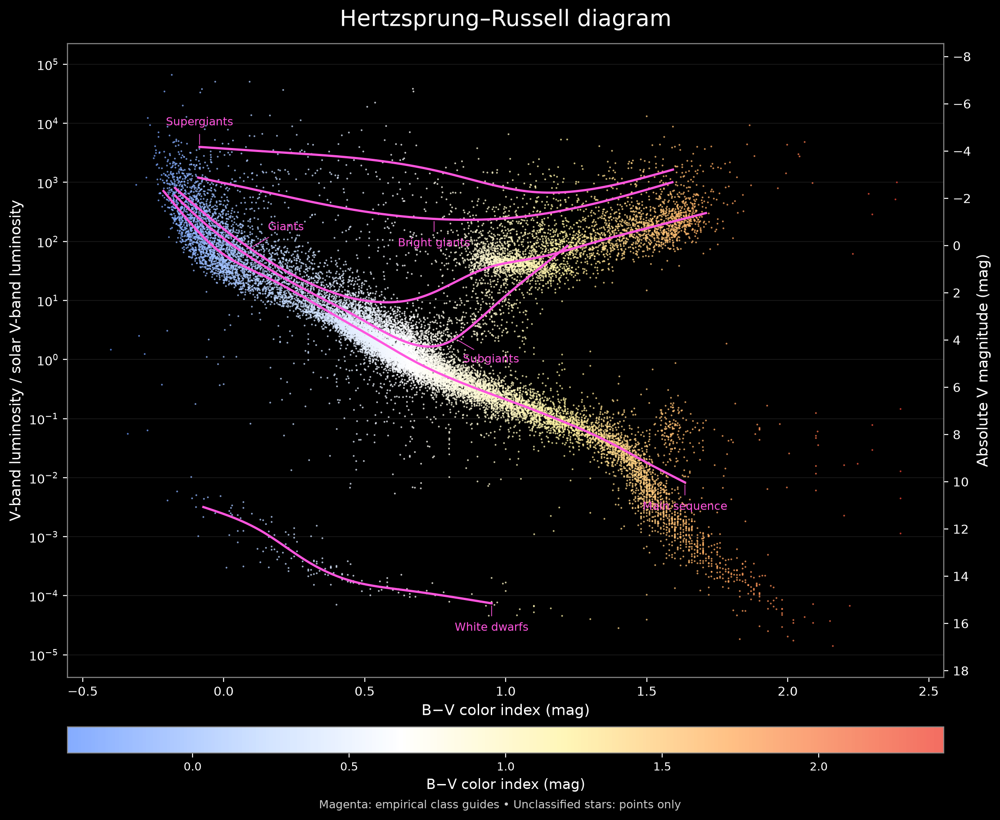

# Complex plots and the H–R demo

The [H–R notebook](../examples/hertzsprung-russell-one-shot.ipynb) now has a short
appearance-focused request, smooth empirical class guides, direct labels, and a strict
one-call limit. The improvements live in ordinary profiling, plotting, execution, and
export modules. No stellar class, astronomical constant, reference curve, or HR-specific
branch was added to the library.



## Architecture decision

Keep one model call responsible for composing the plot, with reusable deterministic
operations for the difficult recurring parts:

- Bounded relationship profiles add grouped coverage, spread, and scale information to
  column summaries. They cover at most two numeric pairs and one small categorical
  grouping, using at most 100,000 sampled rows. Omitted information is reported.
- `smooth_trend` merges sparse neighboring bins, estimates robust centers, and smooths
  them using observation counts. It fits in explicit response units and avoids
  extrapolation. Interpolation alone does not remove statistical noise.
- `label_curves` measures labels in display coordinates and places them with short
  leaders. Layout guidance reserves external colorbar space before labeling.
- `max_model_calls=1` bounds the whole generation operation, including repairs and
  clarification. Exports bundle the used helpers and work without Augplot or credentials.

These are shared primitives rather than a chart grammar, an autonomous tool loop, or a
collection of chart-specific recipes. Offline regressions also exercise grouped nonlinear
relationships, discontinuous time trends on log scales, dense multi-panel labels, simple
plots, and standalone exported code.

Keep the execution guard for this release. It prevents many obvious side effects while
preserving the live Matplotlib Figure API. Replacing it with an OS sandbox would require
a separate execution boundary, dependency packaging, data transfer, resource controls,
and a decision about returning images versus live Python objects. A sandbox would improve
isolation, but would not choose a sound estimator or correct visual layout. See the
[guard's limits](generated-code-guardrails.md); it does not establish scientific or visual
correctness. A hosted service accepting untrusted users should separately design true
process/OS isolation before deployment.

## Recorded evaluation: 2026-10-15

We used the existing ChatGPT connection with `gpt-6.1-sol`, the same prepared public HYG
v4.1 table (21,636 plotted stars), and an original comparison batch of 13 fresh model calls. Each attempt made
exactly one provider call, with history replay and repairs disabled. Failed calls were
counted. No generated curve code was edited to improve a picture.

| Phase | Fresh calls | Rendered at original execution | Rendered by final guard after local replay |
| --- | ---: | ---: | ---: |
| Baseline at `d74e138`, original notebook request | 3 | 2 | Not reinterpreted as new results |
| Development prompt 27 | 3 | 2 | 2 |
| Fixed prompt 28 | 7 | 4 | 7 |
| All post-change attempts | 10 | 6 | 9 |

The baseline pictures had misleading polynomial bends, short/fragmented guides, or
colorbar collisions; neither rendered baseline met the visual rubric. One additional
baseline failed on renderer access. Of the four original post-change failures, one used
an unsupported lambda for a secondary axis. Three used the standard custom-palette
constructor `plt.cm.colors.LinearSegmentedColormap.from_list`. The final guard accepts
that exact constructor call while retaining restrictions on detached modules, callables,
and mutation. Replaying those three **unchanged** responses locally produced the extra
three figures, with **zero additional model calls**. The lambda response remains rejected.

All nine accepted post-change programs were visually inspected against these criteria:
all eligible stars retained; B−V coloring on black; continuous magenta guides over
supported class ranges; six identifiable direct labels; matching V-band luminosity and
absolute-magnitude scales; legible axes and any external colorbar. Local numerical
inspection additionally checked 21,636 scatter observations, the magnitude conversion,
all six labels, and agreement with smoothing the complete observations for each class.
The notebook and image above were subsequently refreshed by executing every cell in a
clean kernel, downloading the catalog and making **one additional fresh model call**
under guard 13. That run succeeded directly, including standalone export and reuse; its
outputs involve no response replay. The exported example displays one chart. This extra
run is recorded separately from the original 13-call comparison in the manifest.

This is an **adaptive engineering evaluation**, not an unbiased prospective 90% success
estimate. The request, guidance, helpers, and compatibility checks evolved between
phases. The baseline request prescribed binned low-degree fits; the revised request
leaves estimation to the shared implementation, so this comparison cannot isolate the
contribution of profiling or smoothing. All seven fixed-prompt responses execute under
the final guard, but three required the later compatibility change. Fresh generations
may vary. The [manifest](assets/hr-evaluation-results.json) records original and replay
outcomes, versions, hashes, and review observations.

A subsequent [five-call smoke evaluation](general-smoke-evaluation.md) covers the
other notebooks and records the additional compatibility changes in validator 13.
The H–R results above retain their original guard-12 evaluation provenance.

## Scientific limits and reference fidelity

These are empirical guides for this prepared sample, not canonical stellar evolutionary
tracks. The catalog labels are mixed and unevenly populated. Ia and Ib are combined as
Supergiants; the reference's separate tracks cannot be recovered from those labels.
At B−V 1.6–1.7, the five main-sequence-labeled observations include three bright
contaminants. The supported smooth main-sequence guide therefore ends around B−V 1.64;
fainter red stars remain visible in the scatter. Extending a reference-like tail would
require an explicit scientific selection or an external theoretical/calibration model.

Automatic smoothing cannot certify the interpretation of arbitrary populations. Broad
physical gaps, mixed classes, sparse tails, and unusual statistical tasks still require
review. The library neither grades the image nor silently enters a multi-step model loop.
The notebook and screenshot retain the HYG [CC BY-SA 4.0 attribution](
https://github.com/astronexus/HYG-Database/blob/main/LICENSE).

## Reproduce a fresh evaluation

After installing the development environment and signing in with `ap.sign_in()`:

```bash
python examples/evaluate_hr.py --runs 3 --output /tmp/hr-evaluation
```

Use `--catalog /path/to/hygdata_v41.csv` to avoid downloading the catalog again.
`--request-file /path/to/request.txt` freezes a different request; `--auth api_key`
selects an explicitly configured API route. The tool never signs in automatically or
switches billing routes. The output directory must be empty. Each attempt saves its
source, figure when available, and a JSON record with model-call counts and numerical
observations. Inspect every image; `automatic_visual_pass` deliberately remains null.
A completed harness run or passing numerical checks does not mean every attempt passed
visual review. Live evaluation consumes usage and is explicitly opt-in.

For a maintenance handoff, run Ruff, the offline suite, package build, clean wheel import,
and the required PR checks. Further model sampling or a scientific fit-quality engine is
not part of this release's acceptance claim.
